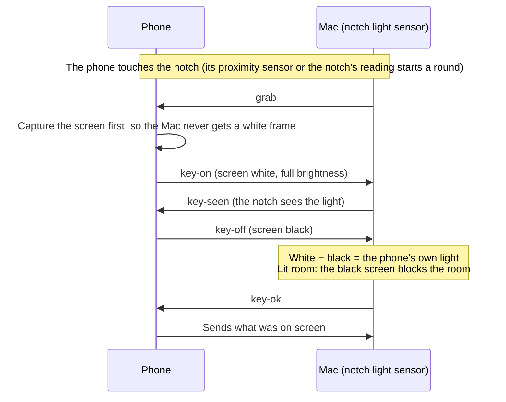

<div align="center">


# TapDrop

**Touch your phone to your Mac's notch. Whatever's on its screen is there.**

AirDrop-style sharing between Android and Mac: tap to send, share sheets both ways, a shared clipboard and
one-time codes. Everything stays on your own Wi-Fi, end-to-end encrypted.


**[Website](https://tapdrop.pages.dev)** ·
**[Download for Mac (.dmg)](https://github.com/0x1p0/TapDrop/releases/latest/download/TapDrop.dmg)** ·
**[Download for Android (.apk)](https://github.com/0x1p0/TapDrop/releases/latest/download/TapDrop.apk)** ·
**[All releases](https://github.com/0x1p0/TapDrop/releases)** ·
**[Step-by-step install guide](docs/INSTALL.md)**

Free and open source. No accounts, no cloud, no tracking.

<br>


<br><br>

<table>
<tr>
<td align="center"><br><sub><b>Menu bar panel</b></sub></td>
<td align="center"><br><sub><b>Android home</b></sub></td>
<td align="center"><br><sub><b>Settings</b></sub></td>
<td align="center"><br><sub><b>Test your tap</b></sub></td>
</tr>
</table>

</div>

---

## Contents

- [What it does](#what-it-does)
- [Tap to send](#tap-to-send)
- [What a tap sends](#what-a-tap-sends)
- [How TapDrop knows it's the notch](#how-tapdrop-knows-its-the-notch)
- [Privacy and security](#privacy-and-security)
- [Get started](#get-started)
- [Updating](#updating)
- [Troubleshooting](#troubleshooting)
- [Uninstalling](#uninstalling)
- [Build from source](#build-from-source)
- [Project layout](#project-layout)
- [Contributing](#contributing)
- [License](#license)

## What it does

| | |
|---|---|
| **Tap to send** | Touch the top of your phone's screen to the notch and hold it until it buzzes, about half a second. The page, PDF, original photo or video, or text on screen lands on the Mac. |
| **Share both ways** | Photos, videos, files, links and text, from the Android share sheet or the Mac's menu bar. Drop files on the menu bar icon to queue them for your phone. |
| **Shared clipboard** | Send the Mac's clipboard to the phone, or the phone's to the Mac, in one tap. |
| **One-time codes** | Codes from texts and notifications appear in the notch and are copied, ready to paste. |
| **Notch island** | Transfers, results and codes animate out of the notch, Dynamic Island style, and never sit under the camera. |
| **Per-app control** | Choose what each Android app sends: Smart, page link, the photo or video on screen, the latest shot, a screenshot, the text on screen, or nothing. |
| **Test your tap** | A live graph of what the notch sees, on both the Mac and the phone, with a plain-words verdict for every tap. |

## Tap to send

1. Open what you want to send on your phone.
2. Touch the **top of the phone's screen** to the **notch**, screen facing the Mac.
3. Hold it there until the phone **buzzes**. That takes about half a second.

The phone's screen flashes white, then black, against the notch. The Mac sees it and the content flies over. With
**Pick before sending** on, you get a moment to tap one photo or drag over some text to send just that part.

<p align="center"></p>

## What a tap sends

Smart mode decides from what's on screen. You can override it per app.

| On the phone | The Mac gets |
|---|---|
| A web page (Chrome, Firefox, Edge, Samsung Internet…) | The page itself, opened in your Mac's browser |
| A PDF or document (Files, Drive, Adobe, Word…) | The file itself |
| A video (WhatsApp, Photos, Files, VLC…) | The original video file, even mid-clip with the controls hidden |
| A photo (Photos, a chat…) | The original photo, full quality |
| The camera | Your newest shot |
| Anything else | A screenshot, also copied to the Mac's clipboard |

Received files go to your Downloads folder by default, or a folder you choose. Links open in your browser, and text and
codes go to the clipboard.

> [!NOTE]
> Android doesn't tell apps which file another app has open. TapDrop finds the original by the name the viewer shows
> (documents) or by fingerprinting your library in the background (photos and videos): a 256-bit hash of each photo,
> and of about one frame per second of each video. A match has to be close and clearly better than every other
> candidate. If it isn't, you get a screenshot, never a guess. Videos are only searched in galleries, chat apps and
> video players. **Settings → Videos for tap** on the phone (and **Tap to Send → Status** on the Mac) shows how many
> videos are ready.

## How TapDrop knows it's the notch

The notch on a MacBook holds an ambient light sensor. TapDrop uses it as a key: **a tap only counts when the notch sees
your phone's own screen light up and then go dark, pressed right against it.**



**The math**

- While the screen is white, the notch reads the phone's light plus a little room light leaking in around it. Once
  it's black, it reads only that leak. **White − black is the phone's own light, whatever the room**: night, daylight
  or sun on the notch.
- Light falls off fast with distance, so white − black must reach **55% of what this phone gives pressed on the
  notch**. A phone held a few centimetres away can't.
- In a lit room the black screen must also drop the notch well below the room's level. Only a phone covering the
  sensor can do that.
- The phone's own level is **learned automatically** from its successful taps (median of the last 12), so it adapts
  to the phone, its brightness, a case and the room. There's nothing to set. Calibrating in Settings just measures it
  up front.

**What can't send:** a hand over the notch, a shadow, a lamp switching on, the sun, a phone held near the Mac, or a
phone tapped anywhere else, such as your palm or the desk. None of them can light the notch and go dark on cue. The full
rules, timings and every verdict are in [PROTOCOL.md](PROTOCOL.md#light-key-tap-to-send).

## Privacy and security

- **Your network only.** Phone and Mac talk directly over your Wi-Fi. No accounts, servers or cloud.
- **End-to-end encrypted.** Pairing uses P-256 ECDH with a six-digit code you compare on both screens, like Bluetooth.
  Every session derives a fresh key with HKDF-SHA256, and every frame is AES-256-GCM with counter nonces, so replayed
  or reordered frames fail.
- **Only at the moment you tap.** The phone looks at its screen only when a tap passes. Screens that block screenshots
  (banking apps, for example) are never captured.
- **Nothing for show.** Test hooks (simulated sensor, auto-pairing) exist only in debug builds.

## Get started

**You need:**
- A Mac with a notch (MacBook Air or MacBook Pro with Apple silicon) on macOS 15 Sequoia or newer. Without a notch you can still share; you just can't tap.
- An Android phone on Android 13 or newer, any brand.
- Both on the same Wi‑Fi. Not a guest network.

The [install guide](docs/INSTALL.md) (also on the [website](https://tapdrop.pages.dev/get-started/)) walks through the same steps with more detail on every screen.

### 1. Install the Mac app

1. Download **[TapDrop.dmg](https://github.com/0x1p0/TapDrop/releases/latest/download/TapDrop.dmg)**. It's always the latest version.
2. Open it, drag **TapDrop** onto **Applications**, then eject the TapDrop disk.
3. Open **TapDrop** from Applications. macOS says *"TapDrop" Not Opened*. Click **Done**, not Move to Trash.

   TapDrop is free, so it isn't notarized by Apple, which costs a yearly fee.
4. Open **System Settings → Privacy & Security**, scroll to **Security**, click **Open Anyway** and confirm. You only do this once.

   Or skip steps 3–4 in Terminal:

   ```sh
   xattr -dr com.apple.quarantine /Applications/TapDrop.app
   open /Applications/TapDrop.app
   ```
5. When macOS asks *Allow "TapDrop" to find devices on local networks?*, click **Allow**.

TapDrop lives in the menu bar (**((·))**) and opens at login. A **Set Up a Phone** window opens the first time. You can always get back to it from the menu bar icon → **Settings** → **Phones** → **Set Up a New Phone**.

### 2. Install the Android app

1. On the Mac, **Set Up a Phone** shows a QR code. Scan it with your phone's camera and tap **Download TapDrop**. Your Mac serves the app over your Wi‑Fi. Or download **[TapDrop.apk](https://github.com/0x1p0/TapDrop/releases/latest/download/TapDrop.apk)** on the phone directly.
2. Open the downloaded **TapDrop.apk**. When Android says it isn't allowed to install unknown apps from this source, tap **Settings**, switch on **Allow from this source**, go back, and tap **Install**.
3. If **Play Protect** warns ("Unsafe app blocked", "doesn't recognise this app"), tap **More details → Install anyway**.

   If it blocks the install with no such button, pause scanning: **Play Store → your profile picture → Play Protect → → Scan apps with Play Protect: off**. Install, then switch it back on.
4. On Samsung (One UI 6+), if nothing happens, switch off **Settings → Security and privacy → Auto Blocker** for the install. On Xiaomi, Redmi or POCO, let the scan finish and tap **Install anyway**.

   Or install from your Mac over USB or wireless debugging:

   ```sh
   adb install -r TapDrop.apk
   ```

### 3. Pair

1. On the phone, open TapDrop and tap **Pair with your Mac**. Pick your Mac.
2. Check that the six digits on the phone and the Mac match, then click **Pair** on the Mac.

If your Mac isn't listed, tap **Can't see your Mac?** → **Edit address** and type the address shown under the QR code, like `192.168.1.20:47914`.

### 4. Turn on tap to send

On the phone's home screen, tap **Turn on tap to send**, then follow the checklist:

1. **Try TapDrop in Accessibility** (only if shown). Android 13+ restricts apps installed from a file, and only offers the way to allow it once you've tried. Tap **Open**, tap **TapDrop — tap your Mac to send** (under **Downloaded apps** or **Installed apps**), and close Android's message (*App was denied access* or *Restricted setting*).
2. **Allow restricted settings.** Tap **App info**, then **⋮** at the top right (it's there now) → **Allow restricted settings**, and confirm.
3. **Turn on TapDrop in Accessibility.** Tap **Open** → **TapDrop — tap your Mac to send** → switch on **Use TapDrop** → **Allow**.
4. **Let it run in the background** (Samsung, Xiaomi, OnePlus, OPPO, vivo, Huawei…). Tap **Allow**, or set **App info → Battery → Unrestricted**.

**Optional:** under **Get the most out of TapDrop**, allow:
- **Original photos & videos**: choose **Allow all**.
- **Any file**: switch on **Allow access to manage all files**.
- **Codes from texts**.
- **Update notifications**.

### 5. Your first tap

Open anything on the phone. Touch the **top edge of its screen** to the **notch**, screen toward the display, and hold it until it **buzzes**, about half a second. It works in any light, from a dark room to sunlight. To practise, open **Test your tap**, on the phone in **Settings** or on the Mac in **Settings → Tap to Send**.

## Updating

Both apps check for a new version once a day (you can switch this off in Settings) and show what's new.

- **Mac:** click **Update Now** in the menu bar panel or in **Settings → About**. TapDrop downloads the new version, checks it, replaces itself and reopens. **Check for Updates…** checks right away.
- **Phone:** tap the notification or the card on Home, then **Update**. The first time, switch on **Allow from this source**. Android then asks you to confirm. TapDrop stays paired, with tap to send on.

To update by hand, install the new [TapDrop.dmg](https://github.com/0x1p0/TapDrop/releases/latest/download/TapDrop.dmg) or [TapDrop.apk](https://github.com/0x1p0/TapDrop/releases/latest/download/TapDrop.apk) over the old one.

## Troubleshooting

<details>
<summary><b>The phone can't find the Mac, or the setup page says "too many retries"</b></summary>

macOS can block an app from your local network after an update, even with the switch on. Open **System Settings → Privacy & Security → Local Network** and switch **TapDrop** off, then on. Both devices must be on the same Wi‑Fi, not a guest network, and the phone mustn't be using mobile data.
</details>

<details>
<summary><b>Taps don't count</b></summary>

Open **Test your tap** on the phone (Settings) or the Mac (Settings → Tap to Send). Touch the **screen side** to the notch and hold until the buzz. The graph and verdict tell you what the notch saw. "Turn your phone around" means the back was facing the notch. TapDrop learns your phone's brightness as you go; **Calibrate** measures it in three holds.
</details>

<details>
<summary><b>A tap sent a screenshot instead of the video or file</b></summary>

Allow **Original photos & videos** and **Any file**. Videos are fingerprinted in the background while the phone is unlocked and cool: **Settings → Videos for tap** shows how many are ready. Streaming apps (YouTube, Instagram, Netflix) don't keep videos as files, so they send a screenshot. On an app's own screen (Settings, a chat, a web app), a fresh screenshot is what's sent. The Mac's **Tap Log** (Settings → Tap to Send) says what the phone matched and why.
</details>

<details>
<summary><b>"Tap to send stopped" on the phone</b></summary>

Android stopped the accessibility service, usually to save battery. Tap the banner in TapDrop, or switch TapDrop off and on in **Settings → Accessibility**, then **Let it run in the background**.
</details>

<details>
<summary><b>"App not installed" on the phone</b></summary>

A TapDrop signed with a different key is installed, for example one you built yourself. Remove it first, then install and pair again:

```sh
adb uninstall app.tapdrop
```
</details>

## Uninstalling

**Mac:** quit TapDrop (**Settings → Quit TapDrop**), then remove the app and its settings and history:

```sh
rm -rf /Applications/TapDrop.app ~/Library/Application\ Support/TapDrop
```

**Phone:** long-press TapDrop → **App info** → **Uninstall**, or `adb uninstall app.tapdrop`.

## Build from source

### Prerequisites

```sh
xcode-select --install          # Swift 6 toolchain (or Xcode 26+; the Mac app needs the macOS 26 SDK)
brew install openjdk@17         # JDK 17 for the Android build
brew install --cask android-commandlinetools
sdkmanager "platform-tools" "platforms;android-37.0" "build-tools;37.0.0"
```

Point Gradle at the SDK with `export ANDROID_HOME=…`, or put `sdk.dir=…` in `android/local.properties`. Android Studio does both for you.

### Mac app

Swift 6, SwiftUI, Network.framework, CryptoKit, IOKit HID.

```sh
git clone https://github.com/0x1p0/TapDrop.git && cd TapDrop
cd mac && swift build                      # debug build
cd mac && ./scripts/build-app.sh           # release build, installed to /Applications and opened
cd mac && ./scripts/build-app.sh --no-install
```

`build-app.sh` signs with your Apple Development identity if you have one, so macOS keeps TapDrop's permissions across rebuilds; otherwise ad hoc. It bundles the Android app when `android/app/build/outputs/apk/release/app-release.apk` exists, so build that first if you want the Mac's setup page to offer it.

### Android app

Kotlin, Jetpack Compose, Material 3 Expressive, Coil, Haze.

```sh
cd android
export JAVA_HOME=$(/usr/libexec/java_home -v 17)
./gradlew :app:assembleDebug               # app/build/outputs/apk/debug/app-debug.apk
./gradlew :app:assembleRelease             # signed with android/keystore.properties, or the debug key without it
adb install -r app/build/outputs/apk/debug/app-debug.apk
```

Release signing reads `android/keystore.properties` (never committed). Keep the same key, or updates won't install over the old app. To make your own:

```sh
keytool -genkeypair -v -keystore android/tapdrop.keystore -alias tapdrop -keyalg RSA -keysize 4096 -validity 10000 -dname "CN=TapDrop"
```

```properties
storeFile=tapdrop.keystore
storePassword=…
keyAlias=tapdrop
keyPassword=…
```

### Checks

Pure JVM, no device needed. `keyCheck` starts its own test Macs from the debug build:

```sh
cd mac && swift build
cd android && ./gradlew :core:keyCheck :core:otpCheck :core:timeCheck
./gradlew :core:integration -Phost=127.0.0.1 -Pport=47913   # against a running Mac app
```

`keyCheck` covers:
- the phone's rules, the Mac's detector, and every light-key verdict: a hand, a lamp, the sun, distance, two phones, a phone dropping mid-tap;
- a dark room's slow brightness ramp, and the lights going off;
- calibration, learning and live-link liveness.

`otpCheck` runs 698 real-world messages, 347 with a code and 351 without.

### Website

The website is in `site/`, built with Astro and deployed to Cloudflare Pages at [tapdrop.pages.dev](https://tapdrop.pages.dev).

```sh
cd site
npm ci
npm run dev        # http://localhost:4321, hot reload
npm run build      # static site in site/dist
npm run preview    # serves the build
npm run deploy     # builds and deploys to Cloudflare Pages (after `npx wrangler login`)
```

### Releasing

Both apps share one version, in [`VERSION`](VERSION). Android's `versionCode` and the Mac's build number come from it: 2.1.0 → 20100.

1. Update `VERSION`, and add the version's notes to [`CHANGELOG.md`](CHANGELOG.md). The apps show them under **What's new**.
2. Commit, tag and push:

   ```sh
   git tag v2.1.0 && git push origin main v2.1.0
   ```
3. [GitHub Actions](.github/workflows/release.yml) builds both apps, signs them, checks both signatures and publishes the release:
   - `TapDrop-<version>-mac.dmg`, the installer;
   - `TapDrop-<version>-mac.zip`, what the Mac app's updater downloads;
   - `TapDrop-<version>-android.apk`;
   - `TapDrop.dmg` and `TapDrop.apk`, the same two under names that never change, so `releases/latest/download/TapDrop.dmg` (and `.apk`) is always the newest;
   - `SHA256SUMS.txt`.
4. Within a day, both apps offer the update. They download it, check it against `SHA256SUMS.txt` and check that it's signed like the installed app, then update in place.

To build the same files locally into `release/`:

```sh
pip install dmgbuild               # lays out the DMG's installer window
scripts/release.sh
```

Repository secrets (**Settings → Secrets and variables → Actions**):

| Secret | What it is |
|---|---|
| `MAC_SIGNING_P12_BASE64`, `MAC_SIGNING_P12_PASSWORD` | The Mac release identity, a self-signed certificate called "TapDrop Release Signing" |
| `ANDROID_KEYSTORE_BASE64`, `ANDROID_KEYSTORE_PASSWORD`, `ANDROID_KEY_ALIAS`, `ANDROID_KEY_PASSWORD` | The Android release key |
| `CLOUDFLARE_API_TOKEN`, `CLOUDFLARE_ACCOUNT_ID` | Deploys the website (a token with only Account → Cloudflare Pages → Edit) |

```sh
base64 -i tapdrop-mac-signing.p12 | gh secret set MAC_SIGNING_P12_BASE64
gh secret set MAC_SIGNING_P12_PASSWORD
base64 -i android/tapdrop.keystore | gh secret set ANDROID_KEYSTORE_BASE64
gh secret set ANDROID_KEYSTORE_PASSWORD; gh secret set ANDROID_KEY_ALIAS; gh secret set ANDROID_KEY_PASSWORD
gh secret set CLOUDFLARE_API_TOKEN; gh secret set CLOUDFLARE_ACCOUNT_ID
```

Every release must be signed with the same two keys, or installed copies can't update. Keep backups. If you fork TapDrop to publish your own builds, make your own keys and update the pinned signatures in `scripts/release.sh`.

## Project layout

```
mac/                 Menu bar app: server, notch sensor and light key, island, panel, settings, setup, updater
  Sources/TapDrop/   NotchSensor · WatchHub (light key rounds) · Server · Island · Panel · Settings* · Setup* · Updater
  scripts/           build-app.sh
  dmg/               The installer window (dmgbuild settings and background)
android/
  app/               Android app: accessibility tap service, overlays, share sheet, settings, pairing, updater
  core/              Shared protocol, crypto and client in pure Kotlin, with the JVM checks
site/                The website (Astro), on Cloudflare Pages at tapdrop.pages.dev
scripts/             release.sh (the release downloads), release-notes.sh (a version's notes from the changelog)
.github/workflows/   Checks on every push; releases on every version tag; the website on every site change
VERSION              The version of both apps
CHANGELOG.md         What's new in each version
docs/INSTALL.md      Step-by-step install guide
docs/DESIGN.md       Design system for both apps (color, type, motion, components, copy)
PROTOCOL.md          Wire protocol, pairing, the light key, live link
```

## Contributing

Issues and pull requests are welcome. Run the checks above before sending a change, and keep the copy in the apps' plain, friendly voice ([docs/DESIGN.md](docs/DESIGN.md)).

## License

[MIT](LICENSE). Free to use, change and share.

<div align="center">
<sub>Made for tapping things on Macs.</sub>
</div>
