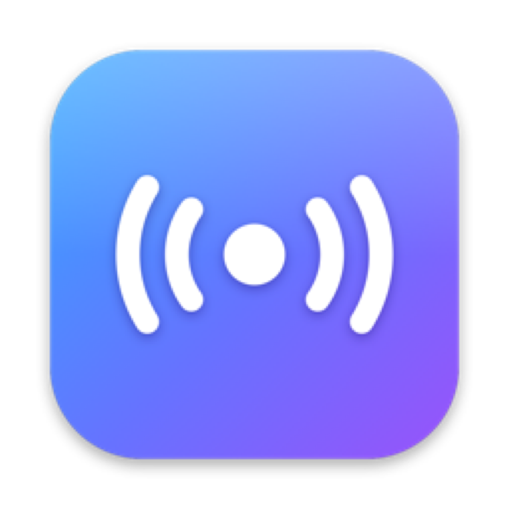
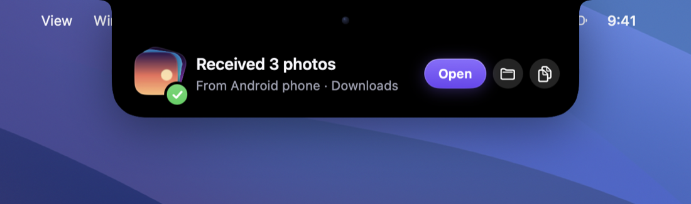
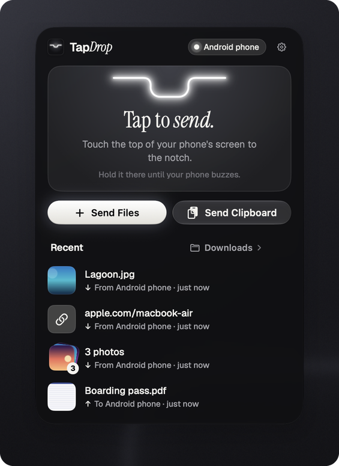
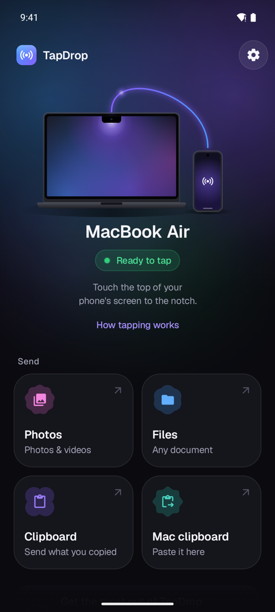
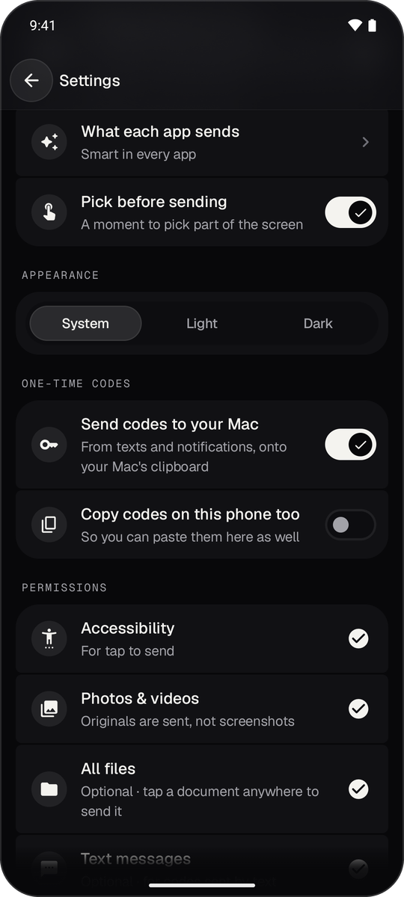
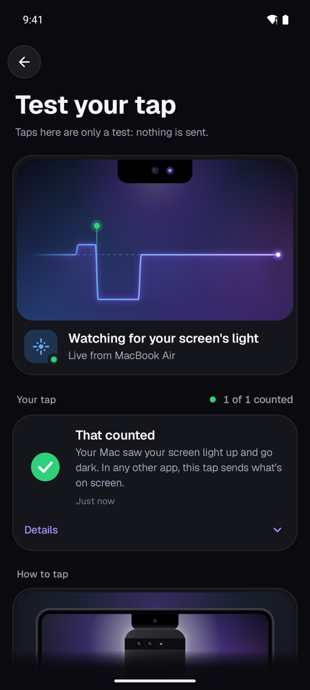
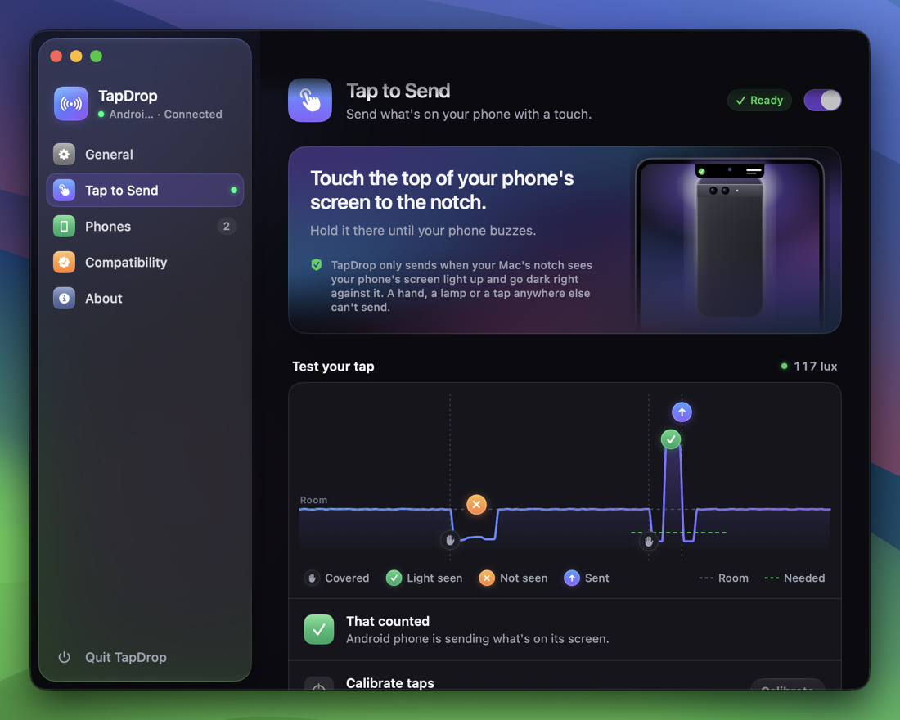
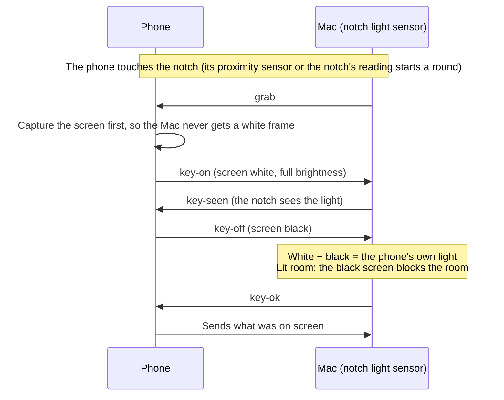

<div align="center">



# TapDrop

**Touch your phone to your Mac's notch. Whatever's on its screen is there.**

AirDrop-style sharing between Android and Mac: tap to send, share sheets both ways, a shared clipboard and
one-time codes. Everything stays on your own Wi-Fi, end-to-end encrypted.


**[Website](https://0x1p0.github.io/TapDrop/)** ·
**[Download for Mac and Android](https://github.com/0x1p0/TapDrop/releases/latest)** ·
**[Step-by-step install guide](docs/INSTALL.md)**

Free and open source. No accounts, no cloud, no tracking.

<br>



<br><br>

<table>
<tr>
<td align="center"><br><sub><b>Menu bar panel</b></sub></td>
<td align="center"><br><sub><b>Android home</b></sub></td>
<td align="center"><br><sub><b>Settings</b></sub></td>
<td align="center"><br><sub><b>Test your tap</b></sub></td>
</tr>
</table>

</div>

---

## Contents

- [What it does](#what-it-does)
- [Tap to send](#tap-to-send)
- [What a tap sends](#what-a-tap-sends)
- [How TapDrop knows it's the notch](#how-tapdrop-knows-its-the-notch)
- [Privacy and security](#privacy-and-security)
- [Get started](#get-started)
- [Troubleshooting](#troubleshooting)
- [Build from source](#build-from-source)
- [Project layout](#project-layout)
- [Contributing](#contributing)
- [License](#license)

## What it does

| | |
|---|---|
| 👆 **Tap to send** | Touch the top of your phone's screen to the notch and hold it until it buzzes, about half a second. The page, PDF, original photo or video, or text on screen lands on the Mac. |
| ↔️ **Share both ways** | Photos, videos, files, links and text, from the Android share sheet or the Mac's menu bar. Drop files on the menu bar icon to queue them for your phone. |
| 📋 **Shared clipboard** | Send the Mac's clipboard to the phone, or the phone's to the Mac, in one tap. |
| 🔑 **One-time codes** | Codes from texts and notifications appear in the notch and are copied, ready to paste. |
| 🏝️ **Notch island** | Transfers, results and codes animate out of the notch, Dynamic Island style, and never sit under the camera. |
| 🎛️ **Per-app control** | Choose what each Android app sends: Smart, page link, the photo or video on screen, the latest shot, a screenshot, the text on screen, or nothing. |
| 🧪 **Test your tap** | A live graph of what the notch sees, on both the Mac and the phone, with a plain-words verdict for every tap. |

## Tap to send

1. Open what you want to send on your phone.
2. Touch the **top of the phone's screen** to the **notch**, screen facing the Mac.
3. Hold it there until the phone **buzzes**. That takes about half a second.

The phone's screen flashes white, then black, against the notch. The Mac sees it and the content flies over. With
**Pick before sending** on, you get a moment to tap one photo or drag over some text to send just that part.

<p align="center"></p>

## What a tap sends

Smart mode decides from what's on screen. You can override it per app.

| On the phone | The Mac gets |
|---|---|
| A web page (Chrome, Firefox, Edge, Samsung Internet…) | The page itself, opened in your Mac's browser |
| A PDF or document (Files, Drive, Adobe, Word…) | The file itself |
| A video (WhatsApp, Photos, Files, VLC…) | The original video file, even mid-clip with the controls hidden |
| A photo (Photos, a chat…) | The original photo, full quality |
| The camera | Your newest shot |
| Anything else | A screenshot, also copied to the Mac's clipboard |

Received files go to your Downloads folder by default, or a folder you choose. Links open in your browser, and text and
codes go to the clipboard.

> [!NOTE]
> Android doesn't tell apps which file another app has open. TapDrop finds the original by the name the viewer shows
> (documents) or by fingerprinting your library in the background (photos and videos): a 256-bit hash of each photo,
> and of about one frame per second of each video. A match has to be close and clearly better than every other
> candidate. If it isn't, you get a screenshot, never a guess. Videos are only searched in galleries, chat apps and
> video players. **Settings → Videos for tap** on the phone (and **Tap to Send → Status** on the Mac) shows how many
> videos are ready.

## How TapDrop knows it's the notch

The notch on a MacBook holds an ambient light sensor. TapDrop uses it as a key: **a tap only counts when the notch sees
your phone's own screen light up and then go dark, pressed right against it.**



**The math**

- While the screen is white, the notch reads the phone's light plus a little room light leaking in around it. Once
  it's black, it reads only that leak. **White − black is the phone's own light, whatever the room**: night, daylight
  or sun on the notch.
- Light falls off fast with distance, so white − black must reach **55% of what this phone gives pressed on the
  notch**. A phone held a few centimetres away can't.
- In a lit room the black screen must also drop the notch well below the room's level. Only a phone covering the
  sensor can do that.
- The phone's own level is **learned automatically** from its successful taps (median of the last 12), so it adapts
  to the phone, its brightness, a case and the room. There's nothing to set. Calibrating in Settings just measures it
  up front.

**What can't send:** a hand over the notch, a shadow, a lamp switching on, the sun, a phone held near the Mac, or a
phone tapped anywhere else, such as your palm or the desk. None of them can light the notch and go dark on cue. The full
rules, timings and every verdict are in [PROTOCOL.md](PROTOCOL.md#light-key-tap-to-send).

## Privacy and security

- **Your network only.** Phone and Mac talk directly over your Wi-Fi. No accounts, servers or cloud.
- **End-to-end encrypted.** Pairing uses P-256 ECDH with a six-digit code you compare on both screens, like Bluetooth.
  Every session derives a fresh key with HKDF-SHA256, and every frame is AES-256-GCM with counter nonces, so replayed
  or reordered frames fail.
- **Only at the moment you tap.** The phone looks at its screen only when a tap passes. Screens that block screenshots
  (banking apps, for example) are never captured.
- **Nothing for show.** Test hooks (simulated sensor, auto-pairing) exist only in debug builds.

## Get started

**You need** a Mac with a notch (Apple silicon, macOS 15 Sequoia or newer), an Android phone on Android 13 or newer
(any brand), and both on the same Wi‑Fi. Without a notch you can still share; you just can't tap.

The **[install guide](docs/INSTALL.md)** has every click, including the macOS and Android warnings. In short:

1. **Mac:** download **TapDrop-*version*-mac.zip** from [Releases](https://github.com/0x1p0/TapDrop/releases/latest),
   unzip it and drag **TapDrop** into Applications. TapDrop isn't notarized (it's free), so the first time, macOS
   blocks it once: **System Settings → Privacy & Security → Open Anyway**. Allow it on your local network when asked.
2. **Phone:** scan the QR code in the Mac's **Set Up a Phone** window. Your Mac serves the Android app over your
   Wi‑Fi. Or download **TapDrop-*version*-android.apk** from Releases. Allow your browser to install apps, and if
   Play Protect warns, tap **More details → Install anyway**.
3. **Pair:** on the phone, **Pair with your Mac** → pick your Mac → check that the six digits match → **Pair** on
   the Mac.
4. **Tap to send:** on the phone, **Turn on tap to send** and follow the checklist: allow restricted settings if
   Android asks, switch TapDrop on in Accessibility, and on some brands let it run in the background.
5. **Optional:** under **Get the most out of TapDrop**, allow **Original photos & videos** and **Any file**, so taps
   send originals and documents rather than screenshots.

**Updating:** both apps check for a new version once a day and show what's new. Click **Update Now** on the Mac, or
tap **Update** on your phone. Everything stays paired.

## Troubleshooting

<details>
<summary><b>The phone can't find the Mac, or the setup page says "too many retries"</b></summary>

macOS blocks apps from your local network unless they're allowed. After a reinstall, the permission can stop applying
even while the switch shows on. Go to **System Settings → Privacy & Security → Local Network** and switch **TapDrop**
off, then on. Both devices must be on the same Wi-Fi, not a guest network.
</details>

<details>
<summary><b>Taps don't count</b></summary>

Open **Test your tap** on the phone (Settings) or the Mac (Settings → Tap to Send). Touch the **screen side** to the
notch and hold until the buzz. The graph and verdict tell you what the notch saw. "Turn your phone around" means the
back was facing the notch. TapDrop learns your phone's brightness as you go; **Calibrate** measures it in three holds.
</details>

<details>
<summary><b>A tap sent a screenshot instead of the video or file</b></summary>

Check **Settings → Videos for tap** on the phone. Videos are fingerprinted in the background while the phone is
unlocked. For documents, allow **Any file** access. Streaming apps (YouTube, Instagram, Netflix) don't keep videos as
files, so they always send a screenshot. The Mac's tap log (Settings → Tap to Send → Tap Log) records what the phone
matched and why.
</details>

<details>
<summary><b>"Tap to send stopped" on the phone</b></summary>

Android sometimes stops accessibility services, especially with battery savers. Open TapDrop and tap the banner to turn
it back on. On Samsung, Xiaomi and similar phones, also follow the battery steps under **Settings → Compatibility**.
</details>

## Build from source

**Mac** (Swift 6, SwiftUI, Network.framework, CryptoKit, IOKit HID):

```sh
cd mac && swift build              # debug build
cd mac && ./scripts/build-app.sh   # release app in /Applications (signed with your Apple Development identity if you have one)
```

**Android** (Kotlin, Jetpack Compose, Material 3 Expressive, Coil, Haze; needs JDK 17 and the Android SDK, e.g. from
Android Studio):

```sh
cd android && ./gradlew :app:assembleRelease
```

Build the Android app first if you want the Mac app to bundle it for its setup page.

Release signing reads `android/keystore.properties` (not committed). Without it, builds use the debug key. Keep the same
key to update an installed app in place.

```properties
storeFile=tapdrop.keystore
storePassword=…
keyAlias=…
keyPassword=…
```

**Checks** (pure JVM, no device needed):

```sh
cd mac && swift build                                   # the tap checks run real test Macs from this build
cd android && ./gradlew :core:keyCheck :core:otpCheck :core:timeCheck
./gradlew :core:integration -Phost=127.0.0.1 -Pport=47913  # against a running Mac app
```

`keyCheck` starts its own test Macs and covers the phone's rules, the Mac's detector, every light-key verdict (hand,
lamp, sun, distance, two phones, a phone dropping mid-tap), calibration, learning and live-link liveness.

### Releasing

Both apps share one version, in [`VERSION`](VERSION). Android's `versionCode` and the Mac's build number come from it
(2.1.0 → 20100).

1. Update `VERSION` and add the version's notes to [`CHANGELOG.md`](CHANGELOG.md). The apps show these notes under
   **What's new**.
2. Commit, then tag and push: `git tag v2.1.0 && git push origin main v2.1.0`.
3. [GitHub Actions](.github/workflows/release.yml) builds both apps, signs them and publishes the release:
   `TapDrop-<version>-mac.zip`, `TapDrop-<version>-android.apk` and `SHA256SUMS.txt`.
4. Within a day, both apps offer the update. They download it, check it against `SHA256SUMS.txt` and check that it's
   signed like the installed app, then update in place.

Signing secrets (repository **Settings → Secrets and variables → Actions**):

| Secret | What it is |
|---|---|
| `MAC_SIGNING_P12_BASE64`, `MAC_SIGNING_P12_PASSWORD` | The Mac release identity, a self-signed certificate called "TapDrop Release Signing" |
| `ANDROID_KEYSTORE_BASE64`, `ANDROID_KEYSTORE_PASSWORD`, `ANDROID_KEY_ALIAS`, `ANDROID_KEY_PASSWORD` | The Android release key |

Every release must be signed with the same two keys, or installed copies can't update. Keep backups.
`scripts/release.sh` builds the same files locally.

## Project layout

```
mac/                 Menu bar app: server, notch sensor and light key, island, panel, settings, setup
  Sources/TapDrop/   NotchSensor · WatchHub (light key rounds) · Server · Island · Panel · Settings* · Setup*
  scripts/           build-app.sh
android/
  app/               Android app: accessibility tap service, overlays, share sheet, settings, pairing
  core/              Shared protocol, crypto and client in pure Kotlin, with the JVM checks
scripts/             release.sh (the release downloads), release-notes.sh (a version's notes from the changelog)
.github/workflows/   Checks on every push; releases on every version tag
VERSION              The version of both apps
CHANGELOG.md         What's new in each version
site/                The website (Astro), published to GitHub Pages
docs/INSTALL.md      Step-by-step install guide
docs/DESIGN.md       Design system for both apps (color, type, motion, components, copy)
PROTOCOL.md          Wire protocol, pairing, the light key, live link
```

## Contributing

Issues and pull requests are welcome. Run the checks above before sending a change, and keep the copy in the apps'
plain, friendly voice ([docs/DESIGN.md](docs/DESIGN.md)).

## License

[MIT](LICENSE). Free to use, change and share.

<div align="center">
<sub>Made for tapping things on Macs.</sub>
</div>
